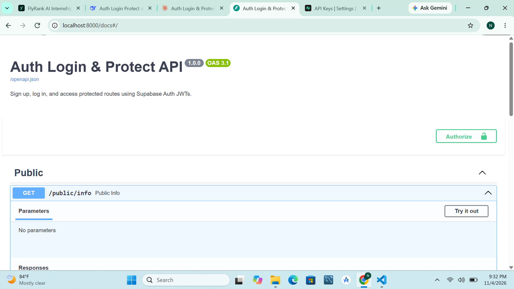

# Auth Login & Protect API

A FastAPI backend that uses **Supabase Auth** as its Identity Provider. Users sign up and log in, receive a JWT, and present it as a Bearer token to access protected routes. Token verification is done through a reusable FastAPI dependency.

## Setup

1. Create a free project at [supabase.com](https://supabase.com) and copy the **Project URL** and **anon key** from *Project Settings → API*.
2. (Easiest for testing) In *Authentication → Providers → Email*, turn off "Confirm email" so new users can log in immediately.
3. Clone and install:
   ```bash
   git clone <your-repo-url> && cd auth-login-protect
   python -m venv venv && source venv/bin/activate   # Windows: venv\Scripts\activate
   pip install -r requirements.txt
   cp .env.example .env                              # then fill in your values
   ```

## Run

```bash
python main.py
```

Expected log: `Server running and connected to Supabase`. Swagger UI: <http://localhost:8000/docs>

## API reference

| Method | Route | Auth required | Success | Errors |
|--------|-------|:---:|---------|--------|
| POST | `/auth/signup` | No | 201 + user object | 400 |
| POST | `/auth/login` | No | 200 + access & refresh tokens | 400, 401 |
| POST | `/auth/logout` | Yes | 204 | 401 |
| GET | `/public/info` | No | 200 | - |
| GET | `/protected/profile` | Yes | 200 + id, email, created_at | 401 |
| GET | `/protected/dashboard` | Yes | 200 | 401 |

## Quick test

```bash
curl -i -X POST http://localhost:8000/auth/signup -H "Content-Type: application/json" -d '{"email":"test@example.com","password":"password123"}'
curl -i -X POST http://localhost:8000/auth/login  -H "Content-Type: application/json" -d '{"email":"test@example.com","password":"password123"}'
curl -i http://localhost:8000/protected/profile -H "Authorization: Bearer <access_token>"
```

## Swagger UI



## Security notes

- `.env` is git-ignored; never commit Supabase keys.
- Only the anon key is used; tokens are verified server-side via `supabase.auth.get_user(token)`.